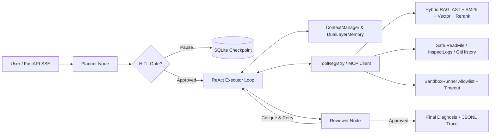

# CodeOps-Agent

> **面向代码库与日志排障的 Multi-Agent 工程助手** — 涵盖原生 `asyncio` ReAct 运行时、LangGraph 风格 `Planner -> Executor -> Reviewer` 状态机、标准 JSON-RPC 2.0 MCP 工具协议、AST Hybrid RAG（BM25 + Vector RRF + Rerank）、上下文工程、SQLite Checkpoint / HITL 断点恢复、FastAPI SSE 流式接口与自动化评测闭环。

[](https://github.com/royhang/codeops-agent/actions/workflows/ci.yml)
[](https://www.python.org/downloads/)
[](LICENSE)

---

## 核心架构 (Architecture)



### 核心工程特性
1. **双引擎 Agent 设计**：
   - 底层 [ReActEngine](src/codeops_agent/agent/react.py)：**不依赖高层编排框架**，纯用 `asyncio` + Pydantic v2 实现，支持并发 Tool Calling（`asyncio.gather`）、参数校验失败自纠错提示与 `max_steps` 防死循环熔断。
   - 上层 [MultiAgentGraph](src/codeops_agent/agent/graph.py)：`Planner -> Executor -> Reviewer` 状态机，支持 SQLite Checkpoint 断点持久化、Human-in-the-Loop（HITL）人工审批恢复以及全链路 SSE 事件推流。
2. **标准 MCP (Model Context Protocol) 支持**：
   - [MCPStdioServer](src/codeops_agent/mcp/server.py) 与 [MCPStdioClient](src/codeops_agent/mcp/client.py) 完整实现 JSON-RPC 2.0 协议（`initialize`、`tools/list`、`tools/call`），支持将工具挂载到任意兼容 MCP 的客户端（Cursor / Claude Desktop / Antigravity）。
3. **代码感知 Hybrid RAG**：
   - [chunker.py](src/codeops_agent/rag/chunker.py) 基于 Python `ast` 按函数/类边界切片；
   - [hybrid.py](src/codeops_agent/rag/hybrid.py) 结合代码分词（`snake_case` / `camelCase` 拆分）的 **BM25** + **局部稠密向量检索** + **RRF 融合** + **符号对齐 Rerank**。
4. **上下文工程与双层记忆**：
   - [ContextManager](src/codeops_agent/context/manager.py) 实现工具超长输出头尾截断（60% 头 + 40% 尾）与超预算滚动历史摘要压缩；
   - [DualLayerMemory](src/codeops_agent/context/memory.py) 结合滑动窗口短期记忆与 SQLite 持久化长期排障记忆。
5. **可复现的自动化评测与可观测性**：
   - 内置带 6 个典型故障的样本仓库（[benchmarks/sample_repo](benchmarks/sample_repo)）、12 条 RAG 检索黄金用例与 6 条端到端排障任务，支持零 API Key 离线评测及接入真实大模型（OpenAI / DeepSeek / 通义千问 / Ollama）对比实验。

---

## 快速开始 (Quickstart)

### 1. 安装环境
```bash
git clone https://github.com/royhang/codeops-agent.git
cd codeops-agent

python3 -m venv .venv
source .venv/bin/activate
pip install -e ".[dev]"
```

### 2. 零配置离线运行（Mock 模式）
项目默认启用 `RuleBasedMockLLMClient`，无需外部 API Key 即可体验完整 Multi-Agent 编排、MCP 工具调用、SSE 界面与评测流程：

```bash
# 运行全部单元测试
pytest -v

# 运行 RAG + Multi-Agent 自动化评测
codeops-agent eval --repo benchmarks/sample_repo --logs benchmarks/sample_logs/app.log

# 命令行执行一次排障任务
codeops-agent run "线上报 ZeroDivisionError: float division by zero in calculate_discount_rate，请定位根因"

# 启动 FastAPI + SSE Web 控制台
codeops-agent serve --port 8000
# 浏览器访问 http://127.0.0.1:8000
```

### 3. 接入真实大模型（OpenAI / DeepSeek / Qwen / Ollama）
```bash
cp .env.example .env
# 在 .env 中设置：
# CODEOPS_LLM_PROVIDER=openai
# CODEOPS_API_KEY=sk-your-api-key
# CODEOPS_BASE_URL=https://api.deepseek.com/v1   # 或其他 OpenAI 兼容接口
# CODEOPS_MODEL=deepseek-chat
```

### 4. 作为标准 MCP Server 使用
```bash
codeops-agent mcp-serve --repo benchmarks/sample_repo --logs benchmarks/sample_logs/app.log
```

---

## 实测基准数据 (Offline Benchmark)

以下命令在本地 Python 3.9.6 环境下实测运行（`provider=mock-offline`，完全可复现）：

```bash
codeops-agent eval --repo benchmarks/sample_repo --logs benchmarks/sample_logs/app.log
```

### 1. Hybrid RAG 检索评测（12 条黄金查询）

| Strategy | Recall@1 | Recall@3 | Recall@5 | MRR@5 |
| --- | ---: | ---: | ---: | ---: |
| BM25 | 66.7% | 91.7% | 100.0% | 0.8125 |
| Vector | 66.7% | 91.7% | 100.0% | 0.8125 |
| Hybrid(RRF) | 66.7% | 91.7% | 100.0% | 0.8125 |
| Hybrid+Rerank | 66.7% | 91.7% | 100.0% | 0.8125 |

### 2. Multi-Agent 端到端排障评测（6 个故障任务）

- **Pass Rate**: `100.0%` (6/6)
- **Tool Grounding Rate**: `100.0%`
- **Avg Tokens / Task**: `3153.0`
- **Latency (P50 / P95)**: `2.75 ms` / `3.79 ms`（离线模拟推理耗时；接入外部 LLM 后主要取决于模型 API 首字与生成延迟）
- **Bad Cases**: `0`

> 如需获取真实大模型评测数据，配置 `.env` 后运行 `codeops-agent eval --output-md eval_reports/real_llm.md` 即可生成对比报告。

---

## 项目结构 & 学习指南

```text
codeops-agent/
├── benchmarks/             # 故障样本服务 (sample_repo)、日志与黄金评测集
├── docs/
│   └── LEARNING_GUIDE.md   # 逐模块源码精读路线与动手改造练习
├── src/codeops_agent/
│   ├── agent/              # ReActEngine, MultiAgentGraph, SQLiteCheckpointStore
│   ├── api/                # FastAPI SSE 服务与单页 Web 控制台
│   ├── context/            # ContextManager (截断/摘要压缩) & DualLayerMemory
│   ├── eval/               # RAG & Agent 自动化评测流水线
│   ├── llm/                # OpenAICompatibleClient & RuleBasedMockLLMClient
│   ├── mcp/                # JSON-RPC 2.0 MCP Stdio Server & Client
│   ├── observability/      # Trace / Span 记录器
│   ├── rag/                # AST Chunker, BM25, Vector, Hybrid RRF + Rerank
│   └── tools/              # Pydantic 工具注册表、安全沙箱与内置工具集
└── tests/                  # 14 项单元测试与集成测试
```

如果你正在从零学习或准备修改本项目作为个人作品集，请直接阅读 **[docs/LEARNING_GUIDE.md](docs/LEARNING_GUIDE.md)**。
